<div align="center">

<a href="assets/banner.svg">
  
</a>

# 🦾 Awesome Teleoperation

### The Definitive Ecosystem of Remote Robot Control, Low-Latency Video Streaming & Fleet Supervision Tools

<p align="center">
  <a href="https://github.com/ishandutta2007/Awesome-Awesome-Awesome"></a>
  <a href="https://discord.gg/jc4xtF58Ve"></a>
  <a href="https://github.com/ishandutta2007/Awesome-Teleoperation/stargazers"></a>
  <a href="https://github.com/ishandutta2007/Awesome-Teleoperation/network/members"></a>
  <a href="https://github.com/ishandutta2007/Awesome-Teleoperation/blob/main/LICENSE"></a>
  <a href="https://github.com/ishandutta2007/Awesome-Teleoperation/pulls"></a>
  <a href="https://github.com/ishandutta2007"></a>
</p>

**Curated list of commercial SaaS platforms, enterprise teleoperation systems, and open-source GitHub projects.**  
*Empowering engineers and researchers to build high-reliability, low-latency remote robot intervention, tele-driving, and imitation learning workflows.*

</div>

---

> 🎯 **SEO & Discovery Keywords:** `teleoperation` • `remote robot control` • `telerobotics` • `autonomous vehicle teleoperation` • `low-latency WebRTC` • `ROS 2 teleop` • `humanoid imitation learning` • `RobOps` • `fleet supervision` • `remote driving` • `SpaceMouse 6-DoF` • `CARLA teleoperation` • `XR robot control` • `tactile feedback`

---

## 📑 Table of Contents

- [🌐 Sector Overview & Market Dynamics](#-sector-overview--market-dynamics)
- [🏢 SaaS & Hosted Commercial Platforms](#-saas--hosted-commercial-platforms)
- [🔓 Open-Source GitHub Projects](#-open-source-github-projects)
- [🏗️ Architectural Guide: Building a Custom Teleoperation Stack](#️-architectural-guide-building-a-custom-teleoperation-stack)
- [🤝 How to Contribute](#-how-to-contribute)
- [⭐ Star History](#-star-history)
- [💖 Support & Community](#-support--community)
- [📜 Disclaimer](#-disclaimer)

---

## 🌐 Sector Overview & Market Dynamics

The global robot teleoperation, telepresence, and remote vehicle intervention market is valued at approximately **$34.8 billion in 2025** and is projected to expand to **$86.4 billion by 2033**, compounding at a **CAGR of ~12.1%**. Market expansion is propelled by strict regulatory requirements for Level 4/5 autonomous vehicles (mandating safety fallback operators), severe labor shortages across off-highway sectors (heavy civil construction, mining, agricultural harvesting), and the massive surge in humanoid robot demonstration collection for foundation Physical AI models (e.g., ACT, Diffusion Policy, OpenVLA).

The sector is currently **moderately fragmented** across specialized vertical domains rather than consolidating into a winner-take-all monopoly. While horizontal RobOps and cloud fleet orchestration layers (e.g., Formant, InOrbit, Viam) are establishing widespread presence for telemetry and WebRTC data planes, edge networking variability, diverse physical hardware interfaces, and domain-specific regulatory certifications (such as ISO 26262 for automotive tele-driving vs. IEC 60601 for surgical telerobotics) have preserved strong niches for specialized vertical leaders.

---

## 🏢 SaaS & Hosted Commercial Platforms

A comprehensive comparison of leading SaaS products and enterprise platforms for remote robot monitoring, teleoperation, and fleet supervision, **sorted descending by company size / valuation**:

| Platform | Core Focus & Capabilities | Company Size / Valuation | Starting Tier Pricing | Free Tier / Trial Limits |
| :--- | :--- | :--- | :--- | :--- |
| **[Viam](https://viam.com/)** | Cloud-native robotics management platform with built-in WebRTC low-latency teleoperation, data synchronization, and multi-cloud fleet orchestration. | **~$220M Valuation**<br>($117M Total Funding; Union Square Ventures, Battery Ventures) | **$5.00/month**<br>(Usage-based billing starts beyond initial credit: $0.05/GB storage, $0.15/GB egress) | **Free forever plan**<br>(Includes first $5/mo cloud services free, unlimited connected machines, data sync & real-time telemetry) |
| **[Fernride](https://fernride.com/)** | End-to-end human-assisted teleoperation and supervised autonomy platform for electric trucks and port terminal tractors. | **~$145M Valuation**<br>(€75M+ / $80M+ Funding; Acquired by Quantum Systems Dec 2025) | **€1,500/vehicle/month**<br>(Autonomous terminal tractor & yard truck teleoperation package) | **30-day proof-of-concept pilot trial**<br>(1 deployment site, up to 2 terminal tractors + remote desk workstation) |
| **[Formant](https://formant.io/)** | Cloud fleet management and low-latency WebRTC teleoperation platform for ROS/ROS2 industrial robots and field systems. | **~$135M Valuation**<br>($45M Total Funding; BMW i Ventures, Intel Capital, SignalFire) | **$250/robot/month**<br>(Starter Fleet package including WebRTC video streaming, telemetry, and alerts) | **Free forever Developer tier**<br>(1 connected robot, 500 MB data/month, 1 user seat, live WebRTC teleop stream) |
| **[Phantom Auto](https://phantomauto.com/)** | Safety-certified remote driving and low-latency teleoperation software for logistics forklifts, yard trucks, and AVs *(Asset acquired)*. | **$95M Funding Raised**<br>(~$120M Peak Valuation; Bessemer Venture Partners, Maniv Mobility) | **$1,250/vehicle/month**<br>(Remote forklift/yard truck teleoperation station license) | **30-day enterprise evaluation pilot**<br>(1 operator command station + 2 retrofitted logistics vehicles) |
| **[Foxglove](https://foxglove.dev/)** | Robotics observability, visualization, and live WebRTC data-streaming platform built for Physical AI and autonomous systems. | **~$100M+ Valuation**<br>($58.7M Total Funding; Series B led by Bessemer Venture Partners) | **$20.00/user/month**<br>(Team/Pro tier with custom visualization layouts, events, and live stream) | **Free forever plan**<br>(Up to 5 connected devices, 3 user seats, 10 GB cloud storage, 100 GB/month bandwidth) |
| **[Vimaan Robotics](https://vimaan.ai/)** | Computer vision and autonomous drone/forklift teleoperation platform for warehouse inventory intelligence and stock reconciliation. | **~$65M Valuation**<br>($25M Funding; Amazon Industrial Innovation Fund, NEA, Wing VC) | **$1,200/month/facility**<br>(PalletSCAN / StorTRACK cloud analytics & drone teleoperation suite) | **14-day warehouse scanning pilot trial**<br>(1 dock door / aisle evaluation kit with live cloud reporting) |
| **[Ottopia](https://ottopia.tech/)** | Low-latency video-bonded teleoperation and remote assistance software for commercial AVs, robotaxis, and heavy industrial fleets. | **~$50M Valuation**<br>($36M Total Funding; Hyundai Motor Group, MizMaa Ventures) | **$350/vehicle/month**<br>(Teleoperation software license for video bonding, low-latency control & fallback) | **30-day technical trial / PoC sandbox**<br>(Up to 2 connected test vehicles on cellular 4G/5G bonding) |
| **[Teleo](https://www.teleo.ai/)** | Retrofit kits and remote command stations for teleoperating heavy construction equipment (bulldozers, wheel loaders, excavators). | **~$50M Valuation**<br>($29.8M Total Funding; UP.Partners, Trucks VC, F-Prime) | **$2,000/machine/month**<br>(Supervised autonomy & remote command station desk subscription) | **30-day pilot deployment assessment**<br>(1 remote command desk + 1 machine retrofit kit on-site) |
| **[Guident](https://guident.com/)** | AI-enabled Remote Monitor and Control Centers (RMCC) and low-latency teleoperation for autonomous shuttles and delivery robots. | **$43.7M Market Cap**<br>($15M Nasdaq IPO Filing GDNT; Subsidiary of Tekcapital) | **$400/vehicle/month**<br>(GuideOn RMCC Remote Monitoring & Teleoperation seat license) | **14-day simulated testbed trial**<br>(Cloud RMCC console access & 1 virtual vehicle streaming feed) |
| **[Freedom Robotics](https://www.freedomrobotics.ai/)** | Cloud robotics management software (RMS) offering remote control, diagnostics, and teleoperation for autonomous systems. | **~$18M Valuation**<br>($6.6M Total Funding; Initialized Capital, Toyota AI Ventures) | **$100/device/month**<br>(Starter tier with remote control, telemetry ingestion, and live streaming) | **14-day full platform free trial**<br>(Up to 3 robots, unlimited telemetry, real-time WebRTC control) |
| **[InOrbit](https://www.inorbit.ai/)** | Robot operations (RobOps) platform providing real-time telemetry, incident intervention, and robot fleet teleoperation. | **~$15M Valuation**<br>($5M+ Total Funding; ANIMO Ventures) | **$50/robot/month**<br>(Developer Edition flat package ~$500/mo for 8 robots; Standard ~$50/MAR) | **Free forever plan**<br>(Unlimited robots, core health monitoring, Adaptive Diagnostics, real-time map tracking) |
| **[DriveU.auto](https://www.driveu.auto/)** | Cellular-bonded low-latency video transmission and teleoperation platform for remote driving of autonomous vehicles and delivery bots. | **~$14M Valuation**<br>($4M Total Funding; Ashdod Port Company, Zohar Zisapel) | **$300/vehicle/month**<br>(Cellular-bonded low-latency video streaming & teleoperation client license) | **30-day developer evaluation trial**<br>(2 vehicle software licenses, SDK access, cloud relay testing) |

---

## 🔓 Open-Source GitHub Projects

Curated open-source projects for self-hosted teleoperation, leader-follower master-slave systems, VR/XR interfaces, and low-latency video streaming pipelines. **Sorted descending by GitHub_Stars_Count**:

1. **[LeRobot (Hugging Face)](https://github.com/huggingface/lerobot)** [](https://github.com/huggingface/lerobot/stargazers)  
   🤖 *State-of-the-art open-source library for real-world robotics and imitation learning by Hugging Face.*  
   Features production-ready teleoperation tools for leader-follower setups (Koch v1.1, SO-100, Franka, ALOHA), real-time camera capture, teleoperated dataset recording, and direct policy deployment with PyTorch.

2. **[Mobile ALOHA](https://github.com/MarkFzp/mobile-aloha)** [](https://github.com/MarkFzp/mobile-aloha/stargazers)  
   🦾 *Low-cost bimanual mobile manipulation framework for learning whole-body robot control.*  
   Provides a complete hardware-software teleoperation system mapping human dual-arm inputs to a mobile robot base, enabling whole-body demonstration collection for complex tasks like cooking and door opening.

3. **[Unitree XR Teleoperate](https://github.com/unitreerobotics/xr_teleoperate)** [](https://github.com/unitreerobotics/xr_teleoperate/stargazers)  
   🥽 *Comprehensive XR teleoperation framework for Unitree humanoid robots (H1, G1).*  
   Directly connects VR/MR headsets (Apple Vision Pro, Meta Quest) to humanoid upper bodies and dexterous hands for low-latency whole-body teleoperation and imitation learning demonstration recording.

4. **[Robomimic](https://github.com/ARISE-Initiative/robomimic)** [](https://github.com/ARISE-Initiative/robomimic/stargazers)  
   📊 *Standardized framework for robot manipulation learning from human teleoperation demonstrations (Stanford/UT Austin).*  
   Includes multi-device teleoperation interfaces (SpaceMouse, VR controllers, keyboards), demonstration collection pipelines, and benchmarked imitation learning algorithms.

5. **[Open-TeleVision](https://github.com/OpenTeleVision/TeleVision)** [](https://github.com/OpenTeleVision/TeleVision/stargazers)  
   👓 *Immersive active visual feedback teleoperation system for humanoid manipulation (CoRL 2024).*  
   Streams stereo RGB video to XR headsets with low-latency active head tracking, allowing operators to teleoperate complex humanoid manipulation with real-time stereoscopic depth perception.

6. **[HumanPlus](https://github.com/MarkFzp/humanplus)** [](https://github.com/MarkFzp/humanplus/stargazers)  
   🕺 *Full-body humanoid shadowing and imitation system (CoRL 2024).*  
   Uses a single RGB camera or VR tracking to teleoperate 33-DoF humanoid robots in real-time, mapping human pose and dexterity directly to humanoid embodiments.

7. **[VisionProTeleop](https://github.com/Improbable-AI/VisionProTeleop)** [](https://github.com/Improbable-AI/VisionProTeleop/stargazers)  
   🍎 *VisionOS App and Python library from MIT Improbable AI for Apple Vision Pro teleoperation.*  
   Streams high-precision Apple Vision Pro hand tracking and skeletal keypoints over WebSockets/WebRTC to teleoperate robotic arms and dexterous hands with real-time video feedback.

8. **[TWIST](https://github.com/YanjieZe/TWIST)** [](https://github.com/YanjieZe/TWIST/stargazers)  
   🔄 *Teleoperated Whole-Body Imitation System (CoRL 2025).*  
   Provides master-to-humanoid mapping algorithms and teleoperation infrastructure for dynamic whole-body locomotion and manipulation using commodity VR headsets.

9. **[DexCap](https://github.com/j96w/DexCap)** [](https://github.com/j96w/DexCap/stargazers)  
   🧤 *Portable and scalable motion capture and teleoperation system for dexterous hand manipulation (RSS 2024).*  
   Uses glove-based tracking and forward kinematics to teleoperate robotic hands and record fine motor demonstrations in unconstrained environments.

10. **[AMO (Adaptive Motion Optimization)](https://github.com/OpenTeleVision/AMO)** [](https://github.com/OpenTeleVision/AMO/stargazers)  
    ⚙️ *Adaptive motion optimization for hyper-dexterous humanoid whole-body teleoperation (RSS 2025).*  
    Compensates for physical embodiment differences between human operators and humanoid robots in real time, optimizing stability and manipulability.

11. **[teleop (SpesRobotics)](https://github.com/SpesRobotics/teleop)** [](https://github.com/SpesRobotics/teleop/stargazers)  
    📱 *WebXR browser-based teleoperation using commodity smartphones and VR headsets.*  
    Runs entirely in the browser using WebXR 6-DoF tracking, transmitting poses via WebRTC/WebSockets to ROS robots without proprietary hardware.

12. **[teleop_twist_keyboard](https://github.com/ros-teleop/teleop_twist_keyboard)** [](https://github.com/ros-teleop/teleop_twist_keyboard/stargazers)  
    ⌨️ *The ubiquitous ROS and ROS 2 keyboard teleoperation node.*  
    Converts keyboard inputs to standard `geometry_msgs/Twist` velocity commands, serving as the foundational teleoperation tool across robotics development.

13. **[BEAVR-Bot](https://github.com/ARCLab-MIT/BEAVR-Bot)** [](https://github.com/ARCLab-MIT/BEAVR-Bot/stargazers)  
    🥽 *Bimanual, multi-embodiment, accessible VR teleoperation system developed by MIT ARC Lab.*  
    Features 90Hz hand tracking via Meta Quest 3S (OpenXR standard), modular IK solvers, collision avoidance, and direct export to the Hugging Face LeRobot dataset format.

14. **[teleop_twist_joy](https://github.com/ros-teleop/teleop_twist_joy)** [](https://github.com/ros-teleop/teleop_twist_joy/stargazers)  
    🎮 *Generic joystick and gamepad teleoperation node for ROS and ROS 2.*  
    Maps Xbox, PlayStation, and Logitech gamepads to velocity twist messages with deadman safety switches and configurable turbo speed toggles.

15. **[TUM Teleoperated Driving](https://github.com/TUMFTM/teleoperated_driving)** [](https://github.com/TUMFTM/teleoperated_driving/stargazers)  
    🏎️ *Full-stack teleoperation software for automated vehicles from Technical University of Munich (IEEE IV 2025).*  
    Supports both Direct Remote Driving (steering wheel and pedals) and Remote Assistance (trajectory guidance), with native ROS 2 and Autoware interfaces.

16. **[Phantom Bridge Client](https://github.com/PhantomCybernetics/phntm_bridge_client)** [](https://github.com/PhantomCybernetics/phntm_bridge_client/stargazers)  
    ⚡ *High-performance WebRTC + Socket.io bridge for ROS 2 teleoperation and real-time streaming.*  
    Achieves **~5-10ms RTT over local Wi-Fi** and ~60ms over 4G LTE with H.264 hardware acceleration (CUDA/VAAPI) and P2P/TURN connectivity.

17. **[TELECARLA](https://github.com/hofbi/telecarla)** [](https://github.com/hofbi/telecarla/stargazers)  
    🚗 *Open-source teleoperated driving extension for the CARLA autonomous vehicle simulator.*  
    Integrates commercial force-feedback gaming steering wheels, multi-camera displays, and realistic network latency simulation for AV teleoperation research.

18. **[lerobot_franka_teleop](https://github.com/Shenzhaolong1330/lerobot_franka_teleop)** [](https://github.com/Shenzhaolong1330/lerobot_franka_teleop/stargazers)  
    🦾 *Teleoperation framework for Franka Emika Research 3 robotic arms built on Hugging Face LeRobot.*  
    Supports joint-level master-slave isomorphic mapping and 6-DoF end-effector pose teleoperation for manipulation dataset recording.

19. **[OpenTera](https://github.com/introlab/opentera)** [](https://github.com/introlab/opentera/stargazers)  
    🏥 *Open tele-rehabilitation and telerobotics framework with WebRTC signaling.*  
    Provides `opentera-webrtc-ros` and a modular Vue.js frontend for remote mobile robot teleoperation, audio/video conferencing, and rehabilitation sessions.

20. **[XR-Robot-Teleop-Server](https://github.com/yunho-c/XR-Robot-Teleop-Server)** [](https://github.com/yunho-c/XR-Robot-Teleop-Server/stargazers)  
    🌐 *High-performance Python server for streaming 360° panoramic video to XR headsets (Quest 3, Vision Pro).*  
    Built with aiortc and FastAPI for low-latency WebRTC streaming, featuring full-body/hand skeleton processing and head-orientation visual reprojection.

21. **[3D Mouse HID](https://github.com/hcrlab/3dmouse-hid)** [](https://github.com/hcrlab/3dmouse-hid/stargazers)  
    🖱️ *Precision filtering and visualization driver for 3Dconnexion SpaceMouse robot control.*  
    Provides deadband smoothing and visual 6-DoF coordinate indicators for teleoperating robotic arm end-effectors.

22. **[helyOS Core](https://github.com/helyOSFramework/helyos_core)** [](https://github.com/helyOSFramework/helyos_core/stargazers)  
    🏰 *Fraunhofer IVI's open-source control tower framework for autonomous mobile machines.*  
    Event-driven microservice architecture for vehicle mission orchestration, path planning, collision avoidance, and operator teleoperation intervention.

---

## 🏗️ Architectural Guide: Building a Custom Teleoperation Stack

To construct a production-ready, self-hosted teleoperation pipeline, consider combining these open-source building blocks:

```
┌─────────────────────────────────────────────────────────────┐
│                    OPERATOR INTERFACE                       │
│  [Open-TeleVision] / [BEAVR-Bot] / [VisionProTeleop]        │
│  • XR Stereo 3D Video Feed (Quest 3 / Apple Vision Pro)     │
│  • 6-DoF Hand / Controller Pose Tracking                    │
└──────────────────────────────┬──────────────────────────────┘
                               │ Low-Latency WebRTC / DTLS
                               ▼
┌─────────────────────────────────────────────────────────────┐
│                 COMMUNICATION & DATA PLANE                  │
│  [Phantom Bridge Client] / [OpenTera WebRTC]                │
│  • H.264/H.265 Hardware Video Encoding (CUDA/VAAPI)         │
│  • Cellular Bonding / P2P NAT Traversal / TURN Fallback     │
│  • Heartbeat Watchdog & Deadman Safety Switch (MQTT/UDP)    │
└──────────────────────────────┬──────────────────────────────┘
                               │ ROS 2 / DDS
                               ▼
┌─────────────────────────────────────────────────────────────┐
│                     ROBOT VEHICLE / ARM                     │
│  [LeRobot] / [TUM Teleoperated Driving] / [Mobile ALOHA]    │
│  • Inverse Kinematics (IK) & Joint Motion Retargeting       │
│  • Autoware Trajectory Guidance / Actuator CAN Bus          │
│  • Real-time Demonstration Recording for Imitation Learning │
└─────────────────────────────────────────────────────────────┘
```

---

## 🤝 How to Contribute

Contributions are warmly welcomed! Help keep this repository the primary reference for robotics teleoperation:

1. 🍴 **Fork the repository** on GitHub.
2. 🌿 **Create a new branch**: `git checkout -b feature/new-teleop-tool`
3. ✏️ **Add your entry** under the appropriate section following the established format:
   - Include: Name, official link, GitHub_Stars_Badge (if open-source), 1–2 sentence description.
   - For SaaS tools: ensure pricing and free trial details are explicitly verifiable.
4. 🚀 **Commit your changes**: `git commit -m 'Add awesome teleoperation tool'`
5. 📬 **Open a Pull Request** with a brief summary of the project.

---

## ⭐ Star History

[](https://star-history.dera.page/#ishandutta2007/Awesome-Teleoperation&type=date&legend=top-left)

---

## 💖 Support & Community

If this curated list has accelerated your robotics research, remote operations, or engineering stack, consider supporting the project:

- ⭐ **Star this repository** to help other roboticists discover it.
- 🍴 **Fork & share** with your team, robotics labs, and online communities.
- ☕ **Sponsor the Maintainer:** Support ongoing curation and maintenance via the [GitHub Sponsor Dashboard](https://github.com/sponsors/ishandutta2007).

---

## 📜 Disclaimer

- This list is **community-curated** for educational, engineering, and research purposes. Inclusion does not imply commercial endorsement.
- Remote teleoperation of physical machines, autonomous vehicles, and heavy industrial equipment involves inherent safety risks. All teleoperation deployments must strictly comply with applicable functional safety regulations (e.g., ISO 26262, ISO 13849, OSHA) and undergo rigorous failsafe validation.
